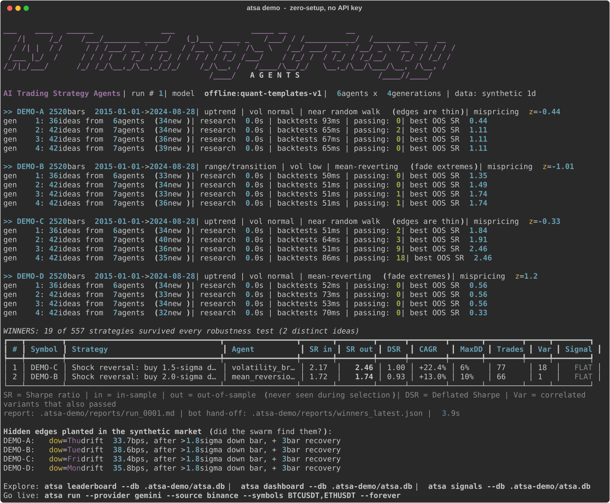
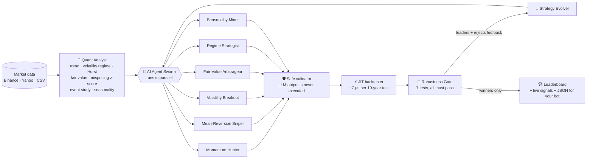

<div align="center">

# 🤖📈 AI Trading Strategy Agents

### Your own AI quant research desk that never sleeps.

**Plug in any LLM → it spins up a team of AI agents → they research the market 24/7, find mispricings,
invent trading strategies, backtest them on years of data → and hand you ONLY the winners.**

[](https://www.python.org/)
[](LICENSE)
[](#-plug-in-any-llm)
[](#-plug-in-any-llm)
[](#-speed)

**`Gemini 4 Neon` + `ai-trading-strategy-agents` = a quant team working for you around the clock.**

</div>

<p align="center"></p>

---

## ⚡ Try it in 60 seconds (no API key needed)

```bash
git clone https://github.com/roan-maverick/ai-trading-strategy-agents.git
cd ai-trading-strategy-agents
pip install -e ".[all]"

atsa demo        # offline agents hunt a synthetic market with hidden edges, in ~5 seconds
```

The demo hides real inefficiencies inside a fake market. Then it lets the swarm loose to see if it can find them.
**It does.** Out of ~550 strategies tested, a handful survive. They're exactly the ones exploiting the hidden edge.

Now point it at real markets with a real brain:

```bash
export GEMINI_API_KEY=your_key_here

atsa run --provider gemini --model gemini-4-neon \
         --source binance --symbols BTCUSDT,ETHUSDT,SOLUSDT --forever
```

That's it. It now runs **24/7**: it refreshes data, does research, generates ideas, backtests, filters, evolves and saves the winners. Then it does it all again.

---

## 🧠 How it works



1. **Research.** A quant analyst (pure math, no LLM) reads the market. It measures trend, volatility regime, Hurst exponent, mean-reversion half-life and 3 fair-value models with mispricing z-scores. It also runs an event study ("what happens after a crash bar?") and checks calendar effects.
2. **Ideas.** Six specialist AI agents read that brief at the same time. Each one proposes strategies in its own style.
3. **Backtest.** Every idea is checked for safety and backtested on years of data, with realistic fills and costs.
4. **Filter.** A brutal robustness gate kills anything that looks lucky, fragile or overfit.
5. **Evolve.** The best strategies and the reasons others failed go back to the agents, who come up with better versions. This repeats for several generations.
6. **Repeat forever.** Yesterday's winners are re-tested on fresh data every cycle. If they stop working, they get demoted.

---

## 🚦 Only winners get through

Most "AI trading bots" show you one beautiful backtest. That's how you lose money: if you try 500 random strategies, a few of them will *always* look amazing by pure luck.

**This engine is built to kill those.** A strategy is a winner only if it passes **every** test:

| # | Test | What it catches |
|---|---|---|
| 1 | **≥ 20 trades** | "Strategies" that got lucky 3 times |
| 2 | **Sharpe ≥ 0.5 in-sample** | Ideas with no edge at all |
| 3 | **Sharpe ≥ 0.5 out-of-sample** (last 30% of history, never seen during selection) | Classic overfitting: great in the past, dead today |
| 4 | **Max drawdown ≤ 35%** | Strategies you could never actually sit through |
| 5 | **Walk-forward: profitable in ≥ 60% of time periods** | One lucky year carrying the whole backtest |
| 6 | **Still profitable at 2× fees + slippage** | Edges that only exist on paper |
| 7 | **Deflated Sharpe Ratio ≥ 0.90** | **Luck from testing many ideas.** It adjusts for how many *independent* ideas the swarm tried (Bailey & López de Prado, 2014) |

Every threshold can be changed in `atsa.yaml`. Every rejection comes with a reason, and those reasons are fed back to the agents so the next generation improves.

---

## 🔌 Plug in any LLM

Swap the "brain" with one flag. No SDKs to install: every provider is a plain HTTP call.

| Provider | Command | Key |
|---|---|---|
| **Google Gemini 4 Neon** (default) | `--provider gemini --model gemini-4-neon` | `GEMINI_API_KEY` |
| OpenAI | `--provider openai --model <model-id>` | `OPENAI_API_KEY` |
| Anthropic Claude | `--provider anthropic --model claude-opus-5-5` | `ANTHROPIC_API_KEY` |
| OpenRouter (hundreds of models) | `--provider openrouter --model <vendor/model>` | `OPENROUTER_API_KEY` |
| Vercel AI Gateway | `--provider vercel --model google/gemini-4-neon` | `AI_GATEWAY_API_KEY` |
| Groq · DeepSeek · xAI · Together · Mistral | `--provider groq` (etc.) `--model <model-id>` | `<PROVIDER>_API_KEY` |
| **Local models** (Ollama, LM Studio, vLLM) | `--provider ollama --model <model>` | none |
| Any OpenAI-compatible server | `--provider custom` + `base_url` in config | optional |
| **Offline** (no LLM, quant templates) | `--provider offline` | none |

New model drops tomorrow? Change `--model` and you're running it. Run `atsa providers` to see which keys are set.
Gemini 4 thinking depth can be tuned with `llm.thinking_level: low | medium | high | xhigh`.

---

## 🏆 Hand the winners to your trading bot

Every cycle writes `reports/winners_latest.json`, a clean contract your bot can read (this entry is from the demo run):

```json
{
  "id": "c586e6512c4b",
  "symbol": "DEMO-C",
  "name": "Shock reversal: buy 2-sigma down bars, hold 5",
  "rules": {
    "entry_long": "zscore(ret,20) < -2.0",
    "exit_long": null,
    "max_hold_bars": 5,
    "stop_loss": 0.05
  },
  "signal_now": "FLAT",
  "metrics": { "sharpe_out_of_sample": 1.92, "deflated_sharpe": 0.93, "max_drawdown": 0.096, "trades": 50 }
}
```

```bash
atsa signals          # what every winner wants to hold at the next open, on the latest data
atsa export bot.json  # top strategies as JSON
atsa dashboard        # live web leaderboard at http://127.0.0.1:8000
```

Strategies are plain readable rules (`rsi(close,14) < 30 and close > sma(close,200)`), so you can port them to any bot, exchange or language. See [`examples/bot_integration.py`](examples/bot_integration.py).

<p align="center"></p>

---

## ⚡ Speed

| What | Measured |
|---|---|
| Core backtest (10 years of daily bars, stops + costs) | **~7 µs** |
| Full scorecard per strategy (signals, in/out-of-sample, walk-forward, 2× cost re-run) | **~850 / second / core** |
| Strategies scored per minute | **~50,000 per core**, scales across cores |

Measured with `atsa bench` on one 2.1 GHz cloud vCPU. Run it on your machine and post your numbers.
The LLM is the slow part (seconds per call), so agents run concurrently and the backtester never makes them wait.

---

## 🧱 Tech stack

| Layer | Choice | Why |
|---|---|---|
| Language | **Python 3.10+** | Every quant and every LLM speaks it |
| Backtest core | **Numba JIT** (LLVM-compiled loops, `nogil`) | C-level speed, no C toolchain needed |
| Data | **NumPy** columnar arrays + **Polars** + **Parquet** cache | Zero-copy, fast loads, works offline after first fetch |
| Strategy language | Safe **AST-whitelisted expression DSL**, memoised indicators | LLM output is *validated*, never `eval`'d; shared indicator cache across thousands of strategies |
| Agents | **asyncio** fan-out + semaphore | All agents think in parallel |
| LLM layer | **httpx** raw HTTP, retries + backoff | Any provider, no vendor SDK lock-in |
| Parallelism | `ProcessPoolExecutor` (forkserver) | Uses every core for big batches |
| Storage | **SQLite** (WAL) | Zero-ops leaderboard, safe for runner + dashboard together |
| Interfaces | **Typer + Rich** CLI, **FastAPI** dashboard | Pretty terminal, live web view |
| Ops | **Docker** + docker-compose, GitHub Actions CI | `docker compose up -d` = 24/7 hunter |

Deep dive: [`docs/ARCHITECTURE.md`](docs/ARCHITECTURE.md)

---

## 🛠️ Commands

| Command | What it does |
|---|---|
| `atsa demo` | Zero-setup demo on a synthetic market with hidden edges |
| `atsa run [--forever]` | Run the hunt once, or 24/7 |
| `atsa research BTCUSDT` | Show the live research brief the agents see |
| `atsa backtest my.json` | Push your own strategy through the same gate |
| `atsa leaderboard` | Best strategies found so far |
| `atsa signals` | Current position for every winner |
| `atsa export winners.json` | JSON hand-off for bots |
| `atsa dashboard` | Web dashboard |
| `atsa bench` | Measure speed on your machine |
| `atsa providers` | List LLM providers + key status |
| `atsa init` | Create `atsa.yaml` + `.env` |

---

## 🌐 Data sources

| Source | Markets | Setup |
|---|---|---|
| `binance` | Crypto (BTCUSDT, ETHUSDT, …), 1m → 1M bars, trades 24/7 | none (public data) |
| `yahoo` | Stocks, ETFs, indices, FX, futures | included in `[all]` |
| `csv` | Anything: your own OHLCV CSV/Parquet files | `data.path: ./data` |
| `synthetic` | Demo market with planted edges | none |

---

## 🧬 Make it yours

**Add your own agent:** just add a name. Any snake_case name becomes a new researcher:

```yaml
swarm:
  agents: [momentum_hunter, fair_value_arbitrageur, crypto_funding_squeeze_hunter, my_secret_style]
```

**Write strategies by hand** and run them through the gate:

```bash
atsa backtest examples/strategies/rsi_dip.json --symbol BTCUSDT --source binance
```

**The strategy language** has 30+ functions: moving averages, RSI, MACD, ADX, ATR, Bollinger bands, stochastics, VWAP, regression fair value, mispricing gap, z-scores, percentile ranks, crossovers, calendar variables and more. See [`docs/STRATEGY_DSL.md`](docs/STRATEGY_DSL.md).

**Add a new LLM provider** in about 20 lines: [`docs/PROVIDERS.md`](docs/PROVIDERS.md).

---

## 🐳 Run it 24/7 with Docker

```bash
cp .env.example .env              # add your GEMINI_API_KEY
cp atsa.example.yaml atsa.yaml    # pick symbols, model, thresholds
docker compose up -d              # hunter + dashboard on http://localhost:8000
```

---

## 🗺️ Roadmap

- [ ] Multi-asset strategies (pairs / stat-arb across symbols)
- [ ] Position sizing models (volatility targeting, Kelly fraction)
- [ ] News & sentiment research agent (tool-calling)
- [ ] Paper-trading connector (CCXT / Alpaca) driven by `atsa signals`
- [ ] Combinatorial purged cross-validation (CPCV)
- [ ] Strategy portfolio builder (combine uncorrelated winners)

PRs welcome. Agents, indicators and providers are each a single file to add.

---

## ⚠️ Read this

This is a **research tool**, not financial advice and not a money printer. Backtests are hypothetical: past performance does not guarantee future results, and markets change. The gate removes a lot of junk, but it cannot remove all risk. **Paper-trade every strategy before you risk real capital**, and never trade money you can't afford to lose. You are responsible for your own trading decisions and for following the rules where you live.

## License

[MIT](LICENSE). Build on it, fork it, ship it.

<div align="center">

**If this saved you a few thousand hours of quant research, drop a ⭐. It helps more people find it.**

</div>
