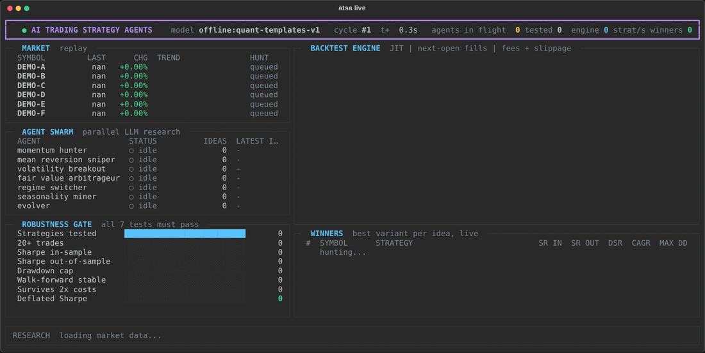
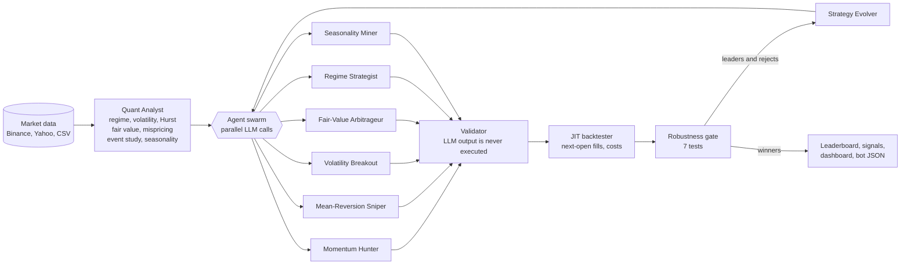
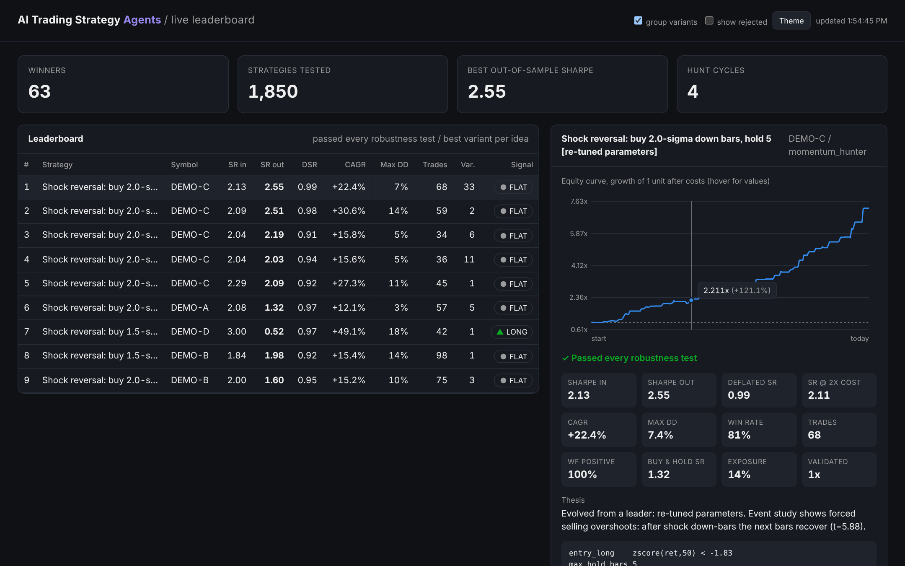

<div align="center">

# AI Trading Strategy Agents

**An open-source, LLM-agnostic quant research desk that discovers, stress-tests and ranks trading strategies around the clock.**

Plug in any language model. A team of AI agents researches the market in parallel, proposes strategies, backtests them
on years of data and hands you only the ones that survive a strict robustness gate.

[](https://github.com/roan-maverick/ai-trading-strategy-agents/actions/workflows/ci.yml)
[](https://www.python.org/)
[](LICENSE)
[](#supported-models)
[](#supported-models)



<sub><code>atsa live --demo</code>: six markets, seven research agents in parallel, 635 strategies backtested and filtered,
winners ranked live. Recorded with the offline provider on the synthetic demo market (playback 3x).</sub>

</div>

---

## Overview

| | |
|---|---|
| **Research agents** | 6 specialists plus an evolver, all running concurrently, across multiple symbols at once |
| **Backtest core** | Numba JIT, about 7 µs per 10-year daily backtest, about 50,000 full scorecards per minute per core |
| **Robustness gate** | 7 tests, including out-of-sample Sharpe, walk-forward stability, 2x cost stress and the Deflated Sharpe Ratio |
| **Models** | Gemini 4 Neon by default; OpenAI, Anthropic, OpenRouter, Groq, DeepSeek, xAI, local models, or no model at all |
| **Output** | Ranked leaderboard, live signals, a web dashboard and a JSON hand-off file for trading bots |
| **Operation** | Runs once or 24/7, re-validates yesterday's winners on fresh data and demotes them when they decay |

**Gemini 4 Neon + ai-trading-strategy-agents = a quant research team that never sleeps.**
When the next model ships, change one flag.

---

## Quick start

```bash
git clone https://github.com/roan-maverick/ai-trading-strategy-agents.git
cd ai-trading-strategy-agents
pip install -e ".[all]"

atsa live --demo     # full-screen command center, no API key required
atsa demo            # the same hunt as a plain terminal report
```

The demo market is synthetic and contains hidden, known inefficiencies. The swarm is not told what they are. Out of
roughly 550 strategies tested per run, only a handful survive, and they are the ones exploiting the hidden edge.
That is the point of the demo: it shows the machinery finds real structure and rejects noise.

<details>
<summary>Sample output of <code>atsa demo</code></summary>
<br>

</details>

Then point it at real markets and a real model:

```bash
export GEMINI_API_KEY=your_key

atsa live --provider gemini --model gemini-4-neon \
          --source binance --symbols BTCUSDT,ETHUSDT,SOLUSDT --forever
```

With `--forever` it loops: refresh data, research, generate, backtest, filter, evolve, store, repeat.

---

## Live command center

`atsa live` is a full-screen terminal dashboard for the hunt:

| Panel | What it shows |
|---|---|
| **Market** | Live Binance prices (or a high-speed replay for other sources) with tick sparklines and per-symbol hunt progress |
| **Agent swarm** | Every agent's state in real time: thinking, ready, ideas produced, latest idea |
| **Backtest engine** | Each strategy as it is scored: pass or fail, Sharpe in and out of sample, Deflated Sharpe, and the reason it was rejected |
| **Robustness gate** | A funnel showing how many strategies survive each of the seven tests |
| **Winners** | The best distinct strategies so far, updated live |
| **Research** | The analyst's current read of each market: regime, fair value, mispricing, shock behaviour |

Record your own clip with your own model: `python scripts/record_live.py --provider gemini --source binance --symbols BTCUSDT,ETHUSDT`.

---

## How it works



1. **Research.** A quant analyst (pure statistics, no LLM) builds a brief for each market: trend and volatility regime,
   Hurst exponent, variance ratio, mean-reversion half-life, three fair-value models with mispricing z-scores, an event
   study of what follows shock bars, and calendar seasonality.
2. **Ideation.** Six specialist agents read the brief concurrently and propose strategies in a strict rule language.
3. **Validation.** Every rule is parsed against a whitelist. Nothing the model writes is executed as code.
4. **Backtesting.** Strategies are simulated with signals at the close, fills at the next open, intrabar stops,
   fees and slippage.
5. **Gating.** Seven robustness tests remove anything lucky, fragile or overfit.
6. **Evolution.** Leaders and the reasons others failed are fed back; agents produce improved variants for several generations.
7. **Persistence.** Winners are stored, re-tested every cycle on fresh data, and demoted if they stop working.

---

## The robustness gate

Run 500 random strategies and a few will always look excellent by chance. The gate is designed to reject them.
A strategy is reported as a winner only if it passes every test:

| # | Test | What it rejects |
|---|---|---|
| 1 | At least 20 trades | Results driven by a handful of lucky trades |
| 2 | Sharpe ≥ 0.5 in-sample | Ideas with no edge |
| 3 | Sharpe ≥ 0.5 out-of-sample (the last 30% of history, never used for selection) | Classic overfitting |
| 4 | Maximum drawdown ≤ 35% | Strategies no one could hold through |
| 5 | Positive Sharpe in at least 60% of walk-forward periods | One good year carrying the whole backtest |
| 6 | Still profitable at 2x fees and slippage | Edges that exist only on paper |
| 7 | Deflated Sharpe Ratio ≥ 0.90 (Bailey and López de Prado, 2014) | Selection luck from testing many ideas. Trials are correlation-clustered, so 30 re-tunes of one idea count as one idea. |

All thresholds live in `atsa.yaml`. Every rejection carries its reason, and those reasons are fed back to the agents.
Winners are grouped by idea cluster, so you receive distinct edges rather than twenty copies of one.

---

## Supported models

Each provider is a plain HTTP integration, with no vendor SDK dependencies.

| Provider | Usage | Key |
|---|---|---|
| Google Gemini 4 Neon (default) | `--provider gemini --model gemini-4-neon` | `GEMINI_API_KEY` |
| OpenAI | `--provider openai --model <model-id>` | `OPENAI_API_KEY` |
| Anthropic | `--provider anthropic --model claude-opus-5-5` | `ANTHROPIC_API_KEY` |
| OpenRouter | `--provider openrouter --model <vendor/model>` | `OPENROUTER_API_KEY` |
| Vercel AI Gateway | `--provider vercel --model google/gemini-4-neon` | `AI_GATEWAY_API_KEY` |
| Groq, DeepSeek, xAI, Together, Mistral | `--provider <name> --model <model-id>` | `<NAME>_API_KEY` |
| Ollama, LM Studio, vLLM (local) | `--provider ollama --model <model>` | not required |
| Any OpenAI-compatible endpoint | `--provider custom` with `llm.base_url` | optional |
| Offline quant templates | `--provider offline` | not required |

`atsa providers` lists which keys are configured. For Gemini 4, reasoning depth is set with
`llm.thinking_level: low | medium | high | xhigh`. Adding a provider takes about 20 lines; see [docs/PROVIDERS.md](docs/PROVIDERS.md).

---

## Bot integration

Each cycle writes `reports/winners_latest.json`. The entry below is from the demo run:

```json
{
  "id": "c586e6512c4b",
  "symbol": "DEMO-C",
  "name": "Shock reversal: buy 2-sigma down bars, hold 5",
  "rules": {
    "entry_long": "zscore(ret,20) < -2.0",
    "exit_long": null,
    "max_hold_bars": 5,
    "stop_loss": 0.05
  },
  "signal_now": "FLAT",
  "metrics": { "sharpe_out_of_sample": 1.92, "deflated_sharpe": 0.93, "max_drawdown": 0.096, "trades": 50 }
}
```

```bash
atsa signals           # target position of every winner at the next open, on the latest data
atsa export bot.json   # top strategies as JSON
atsa dashboard         # web leaderboard at http://127.0.0.1:8000
```

Rules are readable expressions such as `rsi(close,14) < 30 and close > sma(close,200)`, so they port to any bot,
exchange or language. A minimal integration is in [examples/bot_integration.py](examples/bot_integration.py).



---

## Performance

| Measurement | Result |
|---|---|
| Core simulation, 10 years of daily bars with stops and costs | ~7 µs |
| Full scorecard per strategy (signals, in/out-of-sample, walk-forward, 2x-cost re-run) | ~850 per second per core |
| Strategies scored per minute | ~50,000 per core, scaling across cores |

Measured with `atsa bench` on a single 2.1 GHz cloud vCPU. The LLM is the slow step, so agents and symbols run
concurrently and the backtester never holds them up.

---

## Architecture and tech stack

| Layer | Choice | Reason |
|---|---|---|
| Language | Python 3.10+ | The common language of quants and LLM tooling |
| Backtest core | Numba JIT (LLVM-compiled, `nogil`) | Compiled speed without a C toolchain |
| Data | NumPy columnar arrays, Polars, Parquet cache | Zero-copy access, fast reloads, offline after first fetch |
| Strategy language | AST-whitelisted expression DSL with memoised indicators | Safe by construction; one indicator computation shared by thousands of strategies |
| Agents | asyncio fan-out with semaphores, parallel symbols | Concurrent research across agents and markets |
| LLM layer | httpx with retries and exponential backoff | Any provider, no SDK lock-in |
| Parallelism | ProcessPoolExecutor (forkserver) | All cores for large batches |
| Storage | SQLite in WAL mode | Zero-ops; runner and dashboard read and write safely together |
| Interfaces | Typer and Rich CLI, Rich Live terminal UI, FastAPI dashboard | Terminal-first with a web view |
| Operations | Docker, docker-compose, GitHub Actions on Python 3.10 to 3.13 | One command to run 24/7 |

Details: [docs/ARCHITECTURE.md](docs/ARCHITECTURE.md)

---

## CLI reference

| Command | Description |
|---|---|
| `atsa live [--demo] [--forever]` | Full-screen live command center |
| `atsa run [--forever]` | Run the hunt once or continuously, with plain log output |
| `atsa demo` | Zero-setup demo report on the synthetic market |
| `atsa research SYMBOL` | Print the research brief the agents receive |
| `atsa backtest FILE.json` | Run your own strategies through the same gate |
| `atsa leaderboard` | Best strategies found so far |
| `atsa signals` | Current target position for every winner |
| `atsa export FILE.json` | Export winners for a trading bot |
| `atsa dashboard` | Web dashboard |
| `atsa bench` | Measure throughput on your machine |
| `atsa providers` | List model providers and key status |
| `atsa init` | Create `atsa.yaml` and `.env` |

---

## Data sources

| Source | Coverage | Setup |
|---|---|---|
| `binance` | Spot crypto pairs, 1-minute to monthly bars | None (public market data) |
| `yahoo` | Equities, ETFs, indices, FX, futures | Included in `[all]` |
| `csv` | Your own OHLCV files, CSV or Parquet | `data.path` |
| `synthetic` | Demo market with planted inefficiencies | None |

---

## Extending

Add a research agent by name. Any snake_case name becomes a new researcher with its own mandate:

```yaml
swarm:
  agents: [momentum_hunter, fair_value_arbitrageur, funding_squeeze_hunter, my_house_style]
```

Run hand-written strategies through the gate:

```bash
atsa backtest examples/strategies/rsi_dip.json --symbol BTCUSDT --source binance
```

The rule language has 30+ functions: moving averages, RSI, MACD, ADX, ATR, Bollinger bands, stochastics, VWAP,
regression fair value, mispricing gap, z-scores, percentile ranks, crossovers and calendar variables.
See [docs/STRATEGY_DSL.md](docs/STRATEGY_DSL.md).

---

## Deployment

```bash
cp .env.example .env              # add GEMINI_API_KEY
cp atsa.example.yaml atsa.yaml    # symbols, model, thresholds
docker compose up -d              # 24/7 hunter + dashboard on http://localhost:8000
```

---

## Roadmap

- Multi-asset strategies (pairs and statistical arbitrage)
- Position sizing models (volatility targeting, fractional Kelly)
- News and sentiment research agent with tool calling
- Paper-trading connectors (CCXT, Alpaca) driven by `atsa signals`
- Combinatorial purged cross-validation
- Portfolio construction from uncorrelated winners
- Gemini 4 Neon + this REPO = can probably make upto $100,000 a month 

Contributions are welcome. Agents, indicators, providers and data sources are each a single file; see [CONTRIBUTING.md](CONTRIBUTING.md).

---

## Disclaimer

This project is a research tool. It is not financial advice and does not guarantee profits. Backtests are hypothetical,
past performance does not predict future results, and markets change. The robustness gate removes many false positives
but cannot remove risk. Paper-trade any strategy before committing capital, never trade money you cannot afford to lose,
and make sure your use complies with the regulations that apply to you.

## License

[MIT](LICENSE)

If this project is useful to you, consider starring the repository so others can find it.
